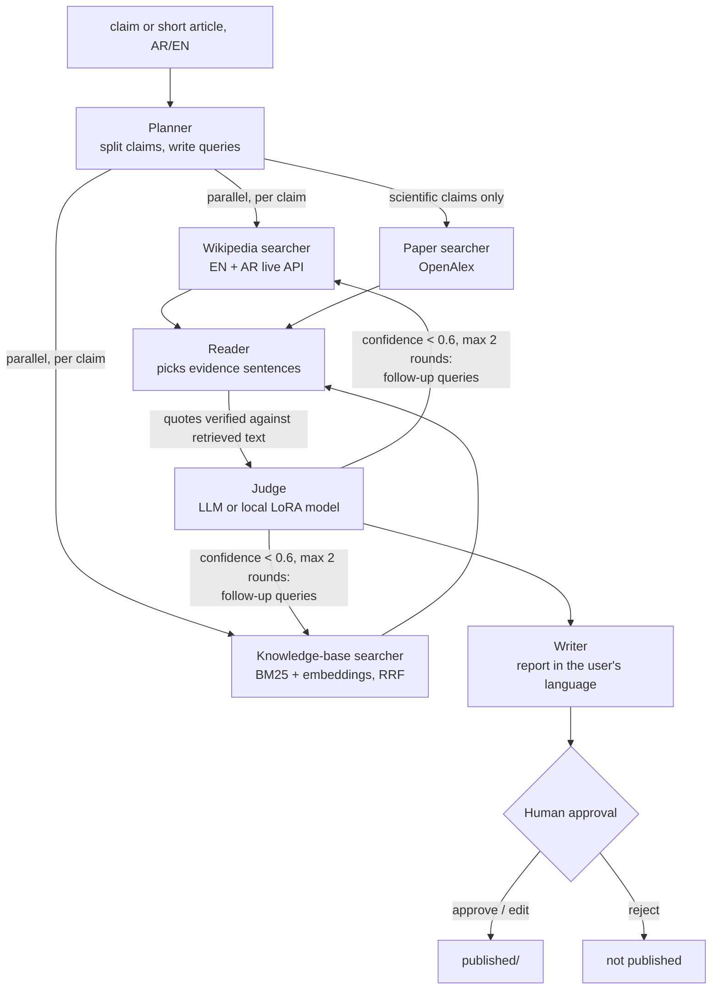

# Bilingual Fact-Checker (Arabic + English)

A multi-agent system that checks claims against evidence and answers **TRUE / FALSE / NOT ENOUGH INFO**
with **verified citations**, in the user's language. Every verdict passes a human approval step before it is
published. Built to be measured: single agent vs agent team, on FEVER (English) and AraFacts (Arabic), with
accuracy, evidence quality, hallucinated citations, cost and latency per claim.

This folder is **self-contained** (own code, config, venv, data, tests) and can be deployed on its own.

```
$ make check CLAIM="The Chaperone (film) was directed by Michael Bay only."

❌ FALSE (confidence 1.00)
The 2011 film The Chaperone was directed by Stephen Herek, not Michael Bay.
- "The Chaperone is a 2011 American comedy film directed by Stephen Herek, and also produced by
   WWE Studios." — The Chaperone (film), sentence 0
1 claim · 1 round · 4 LLM calls · 1 tool call · $0.001
publish? [a]pprove / [e]dit / [r]eject
```
<sub>Real output from one run (gemini-3.1-flash-lite via OpenRouter, local knowledge base only).</sub>

## How it works



| Agent | Job | Output (validated JSON) |
|---|---|---|
| Planner | split text into ≤5 checkable claims, English gloss, search queries (AR + EN for Arabic) | `PlannerOut` |
| Searchers | Wikipedia (live, EN/AR), local KB (FEVER 2017 Wikipedia), OpenAlex papers; run **in parallel** (LangGraph `Send`) | `DocBatch` |
| Reader | choose ≤6 supporting / refuting sentences; every quote is checked against the retrieved sentence | `ReaderOut` |
| Judge | verdict + confidence from the reader's **verified** evidence only, cites by number; asks for more evidence if unsure | `JudgeOut` |
| Writer | headline + explanation in the user's language; citations are rendered from verified evidence, never written by the LLM | `WriterOut` |
| Baseline | ONE ReAct agent with the same tools, for comparison | `AgentStep`, `VerdictDraft` |

**Hallucination control.** A citation is valid only if its `source_id` was retrieved in this run, the sentence
number was shown, and the quote matches that sentence. Invalid reader quotes never reach the judge, judge
references to non-existent evidence are dropped, and both are counted in the benchmark as *fake citations*.

**Tracing.** Every LLM, embedding and tool call is one JSON line in `traces/<run_id>.jsonl`
(tokens, cost from OpenRouter, latency, claim id). `make trace RUN=<run_id>` summarises a run.

## Setup

```bash
make setup          # uv sync + .env + prices.toml
```
Edit `.env`:
- `AWS_BEARER_TOKEN_BEDROCK` (Bedrock API key) and `AWS_REGION`: **Claude in Amazon Bedrock is the default for every
  LLM call** (flash = Claude Haiku 5.5, pro = Claude Opus 5.5; `make models` lists the ids). Enable model access in the
  Bedrock console first.
- optional `OPENROUTER_API_KEY` for `BACKEND=openrouter` (and for embeddings, `make kb`)
- `HTTP_USER_AGENT` with **your contact** (GitHub URL or email). Wikimedia blocks requests without it.
- optional `OPENALEX_API_KEY` (free, own daily budget)

Then:
```bash
make smoke          # one structured LLM call
make data           # FEVER test sample (300), FEVER train sample (4,500, for LoRA), AraFacts sample (125)
make kb             # 1.7 GB FEVER Wikipedia dump -> 5,159 pages -> 11,172 chunks -> embeddings (~$0.02)
make kb-bm25        #   ...or the same without embeddings (free; retrieval falls back to BM25)
make kb-eval        # retrieval recall
```

## Commands

| Command | What it does |
|---|---|
| `make check CLAIM="..."` | agent team → report → your approval → `published/` |
| `make check-single CLAIM="..."` | single-agent baseline |
| `make bench MODE=single\|team [DATASET=fever\|arafacts] [LIMIT=30]` | benchmark; per-claim rows + summary in `results/` (`--resume` continues) |
| `make bench MODE=team JUDGE=lora:factjudge` | team with the local LoRA judge |
| `make compare` | one table of all runs → `results/RESULTS.md` and the section below |
| `make lora-data` → Colab → `make ollama-judge` → `make judge-eval` | LoRA judge pipeline (below) |
| `SEARCHERS=kb` (any command) | restrict searchers, e.g. `kb` only (no live Wikipedia) |
| `TIER=pro`, `JUDGE=llm:pro`, `BACKEND=bedrock\|openrouter\|vertex\|ollama` | switch model tier / judge / backend |
| `make test` | 37 offline tests (fake LLM, no network, no cost) |

## Data and licences

| Data | Use | Licence |
|---|---|---|
| [FEVER](https://fever.ai) shared-task dev split | 300-claim test set, 100 per label, seed 42 | Wikipedia-derived (CC BY-SA 3.0); see fever.ai |
| FEVER train split | 4,500 claims → LoRA training data (disjoint from the test set) | same |
| FEVER June-2017 Wikipedia dump (intros) | local knowledge base | CC BY-SA 3.0 |
| [AraFacts v2](https://gitlab.com/bigirqu/AraFacts) | 125 Arabic claims: 50 TRUE, 50 FALSE, 25 Unverifiable→NEI | **CC BY-NC 4.0 (non-commercial)** |
| Wikipedia API (EN, AR) | live searcher | CC BY-SA |
| [OpenAlex](https://openalex.org) | paper searcher | CC0 |

AraFacts sampling: text claims only (no image/video claims), questions dropped ("هل ...؟" has no truth value),
Partly-false and Sarcasm left out. The `description` column is never used: it contains the fact-checker's answer.

## Results

### Retrieval (measured)
Local KB, BM25 only, 200 verifiable test claims (`make kb-eval`):

| | top 1 | top 3 | top 5 | top 10 |
|---|---|---|---|---|
| gold evidence page found | 76% | 95% | 97% | 98% |
| complete gold evidence set in retrieved chunks | 62% | 82% | 87% | 90% |

Hybrid (BM25 + `baai/bge-m3` embeddings) and LLM-rerank rows appear after `make kb` with embeddings.

### Fact-checking
<!-- RESULTS:START -->
| dataset | mode | model | judge | searchers | n | accuracy | macro-F1 | FEVER score | gold page cited | fake citations | $ / claim | s / claim | errors |
|---|---|---|---|---|---|---|---|---|---|---|---|---|---|
| fever | single | qwen.qwen3-235b-a22b-2507 | llm | wiki,kb,papers | 30 | 63.3% | 0.563 | 3.3% | 60.0% | 29.3% | 0.0017 | 9.2 | 0 |
| fever | team | qwen.qwen3-235b-a22b-2507 | llm | wiki,kb,papers | 30 | 56.7% | 0.478 | 40.0% | 85.0% | 0.0% | 0.0017 | 13.8 | 1 |

`?` after a cost = some calls had no known price. FEVER score = label correct and a complete gold evidence set cited (KB citations only).
<!-- RESULTS:END -->

### Judges on fixed evidence (step 11)
`make judge-eval` compares judges on the same 297 claims with the same evidence. This isolates the judge, so
differences come from the judge alone: Gemini (cloud, paid) vs base Qwen3-4B (local) vs LoRA Qwen3-4B (local).
_Not run yet._

## LoRA judge (data stays on-premises)

1. `make lora-data` → `data/lora/train.jsonl` (4,255), `val.jsonl` (223), `judge_eval.jsonl` (297), balanced labels.
   The evidence format is identical for training and evaluation, and comes from `factcheck/judge_lora.py`.
2. Open `lora/train_judge.ipynb` in Google Colab (free T4) and upload the two files. It trains
   **unsloth/Qwen3-4B-Instruct-2507** (Apache-2.0) with LoRA r=16 for one epoch, learning the answer only,
   checks validation accuracy, and exports `factjudge-Q4_K_M.gguf`.
3. Put the GGUF file in `lora/`, then run `make ollama-base` and `make ollama-judge`. Ollama is installed
   **once, system-wide**, and shared by all projects.
4. `make judge-eval`, then `make bench MODE=team JUDGE=lora:factjudge`.

The LoRA judge returns a label only, so its confidence is fixed at 1.0 and the "search again" loop does not
trigger with it.

## Build status

| Step | Status |
|---|---|
| 1-2 Setup, `agentcore` (LLM layer, structured output, tracing, approval, evals, embeddings) | ✅ done; live calls verified on OpenRouter |
| 3 Tools: Wikipedia EN/AR, OpenAlex, fetch page | ✅ all verified live (EN + AR Wikipedia, OpenAlex) |
| 4 FEVER test set | ✅ 300 claims, balanced |
| 5 Single-agent baseline | ✅ verified live on single claims; full benchmark not run (credits) |
| 6 RAG: KB from FEVER dump, BM25 + embeddings + RRF + optional LLM rerank | ✅ KB built, BM25 recall measured; embeddings need `make kb` (~$0.02) |
| 7 Agent team (LangGraph: parallel searchers, reader, judge loop, writer) | ✅ verified live on single claims; tested offline end-to-end |
| 8 Human approval before publish (`interrupt` → approve / edit / reject) | ✅ tested offline; needs an interactive terminal |
| 9 Benchmark single vs team (+ FEVER score, fake citations, cost, time) | ✅ pipeline verified on 3 claims; full runs not done (credits) |
| 10 Arabic: AR Wikipedia, AR queries, AR reports, AraFacts sample | ✅ verified live on one Arabic claim (AR Wikipedia citation, AR report); AraFacts benchmark not run |
| 11 LoRA judge: data, Colab notebook, Ollama Modelfile, judge comparison | ✅ data built; training/eval needs Colab + Ollama |
| 12 README + demo | ✅ README; results fill in via `make compare`; demo video to record |

## Honest caveats
- **Closed-world KB.** The local KB contains the gold pages of the 300 test claims, plus ~2,000 title-matched
  pages and 3,000 random pages as distractors. It measures retrieval and reasoning, not open-web search.
  3 of 214 gold pages were missing from the dump.
- **FEVER labels are based on 2017 Wikipedia.** Live Wikipedia has changed since then, so the live searcher can
  disagree with the gold label for good reasons.
- **AraFacts.** Most claims are social-media rumours that Wikipedia does not cover, so expect many
  NOT_ENOUGH_INFO answers. That is the correct behaviour for a system that refuses to use model memory.
- **Model memory is not evidence.** The agents are told to use only retrieved evidence. A claim whose page is
  not in the KB gets NOT_ENOUGH_INFO even when the model "knows" the answer.

## Demo video (to record)
1. `make check CLAIM="The Burj Khalifa was completed in 2015."`: parallel search, FALSE with citations, approve → `published/`.
2. The same claim in Arabic: `make check CLAIM="اكتمل بناء برج خليفة في عام 2015"`, which gives an Arabic report.
3. A claim with a hallucinated quote caught (show `✗ quote does not match` in `make check-single`).
4. `make compare` table, and `make judge-eval` (Gemini vs local LoRA).

## Layout
```
agentcore/       this project's copy of the core: llm (OpenRouter/Vertex/Ollama), embed, trace, approval, evals
factcheck/       tools/, kb/ (dump reader, page selection, index, retriever, eval), baseline.py, team.py,
                 bench.py, report.py, fever.py, arafacts.py, judge_lora.py, lora_data.py, judge_eval.py
lora/            Colab notebook + Ollama Modelfile
data/            samples (committed); raw/, cache/, kb/, lora/ are generated (git-ignored)
results/         benchmark rows + summaries + RESULTS.md
traces/          one JSONL per run (git-ignored)
tests/           offline tests
```
